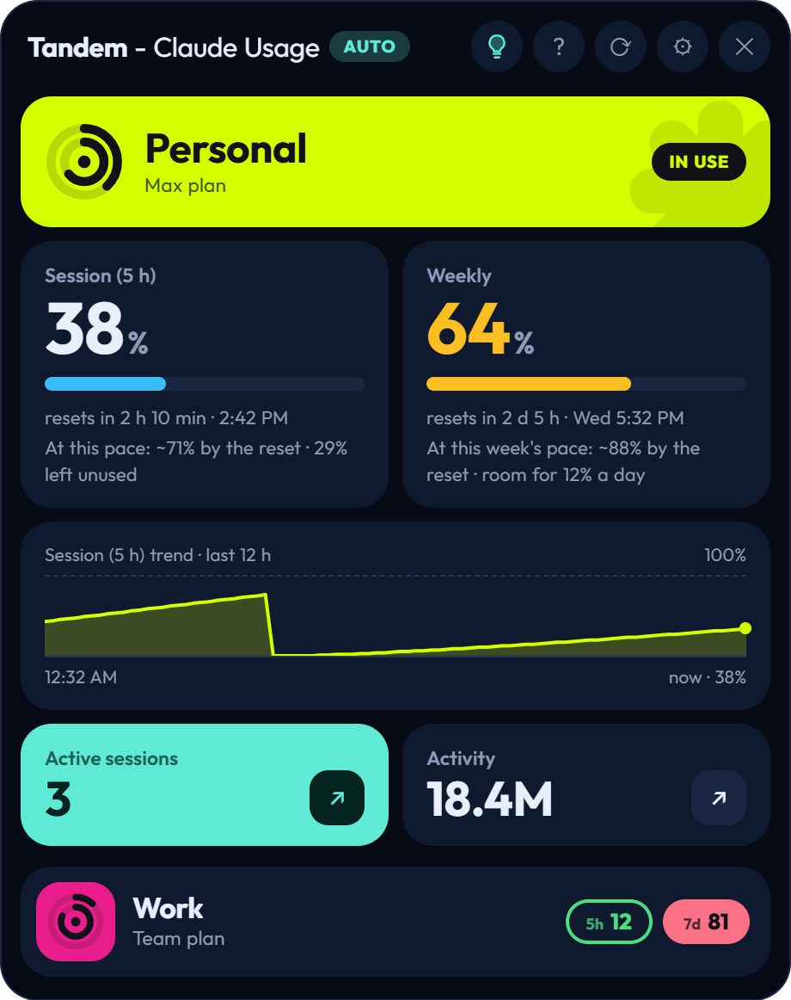
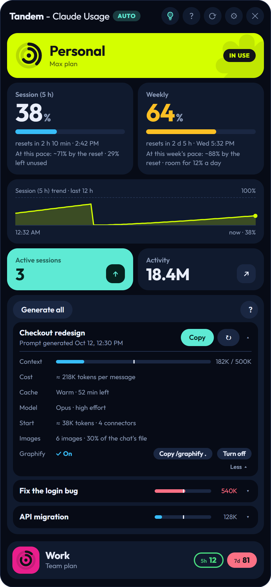
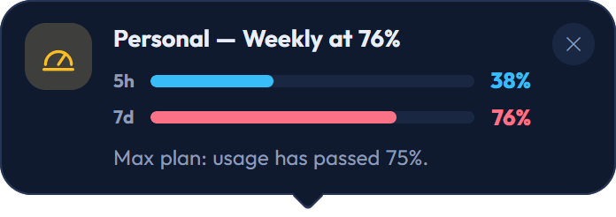
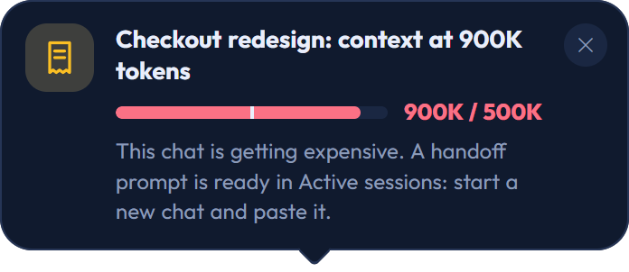
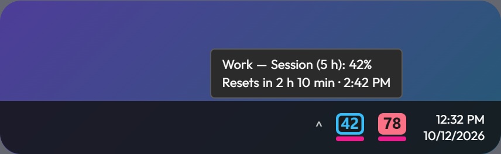
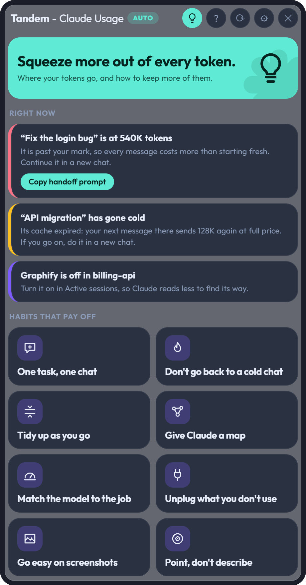

# Tandem — Claude Usage

A small Windows app that lives next to your clock and shows how much of your Claude limits each of your
accounts has used. When one account runs out in the middle of a Claude Code chat, Tandem helps you carry that
chat over to another.

> **Unofficial.** Tandem is not affiliated with, endorsed by or supported by Anthropic. It reads your own usage
> from claude.ai the way the website shows it to you, and may stop working if the site changes.

<p align="center">
  
  
</p>

## What it does

- **Every account at a glance.** One block of tiles per account: the 5-hour session and the weekly limit as
  big numbers, any extra usage, when each resets, and where each is heading at your current pace. Each goes
  from green to blue, orange and red as it is used up.
- **Knows which account is in use.** It finds the account your Claude apps are on right now and shows it in
  two small icons next to the clock: one for the session, one for the week.
- **Warns you in time.** At two thresholds you choose, when the account in use is about to run out (and
  which other account has room), and when a chat has grown past the size you set. The alerts show right
  above Tandem's icons, with the limits as bars; they can be the notifications of Windows instead.
- **Active sessions.** The Claude Code chats you used in the last 24 hours, each with the size of its context,
  whether its prompt cache is still warm, what a message costs, its model and effort, how many connectors it
  loads and how many images it carries.
- **Handoff prompts.** One click writes a prompt that sums a chat up (its folder, what you asked, your last
  messages, the files in play) so you can continue it in a new chat with another account. No model is called.
- **Tips.** A view with what you could do right now to spend fewer tokens, taken from your own chats, plus
  eight habits that pay off and how to apply each.
- **Graphify, optionally.** If you have the `graphify` command-line tool installed, Tandem can turn its
  knowledge graph on or off for a chat's project.
- A guided tour for new users, five themes, and an optional glass effect.
- In English, Spanish, Brazilian Portuguese, French, German and Japanese. A new install starts in the
  language of your system; you can change it in Settings.

<p align="center">
  
  
</p>

<p align="center">
  
  
</p>

The pictures show made-up accounts, chats and figures.

## Install

1. Download `Tandem.Setup.x.y.z.exe` from the [latest release](../../releases/latest).
2. Run it. The installer is not code-signed, so Windows SmartScreen will warn you: choose **More info → Run
   anyway**.
3. Tandem opens next to the clock. Add an account in Settings and sign in to claude.ai in the window that opens.

Requires Windows 10 or 11 (64-bit). The glass effect needs Windows 11 22H2 or later.

## Updates and feedback

- **Updates.** Tandem tells you when a newer version is out, with a notice in the app and a notification
  that take you to the download. Updating is running the newer installer over the old one; accounts,
  sign-ins and settings are kept. Version 0.4.0 does not check: if you have it, get the latest once by hand.
  What changed in each version is in the [changelog](CHANGELOG.md).
- **Feedback.** Ideas and problems are welcome as [issues](../../issues/new/choose). There is a button for
  it at the bottom of Settings.

## Privacy

- **Your password never reaches Tandem.** You sign in on claude.ai itself, in a browser window of the app.
  Each account gets its own isolated session, stored in Tandem's data folder like a browser profile.
- **It talks to claude.ai, and nothing of yours goes anywhere else.** There is no server of its own, no
  analytics and no telemetry. Twice a day it asks GitHub for the number of the latest version; you can
  turn that off in Settings.
- **Everything else is read locally and stays there.** To list your chats, Tandem reads the Claude Code
  transcripts in `~/.claude/projects` and the session list of the Claude desktop app.
- **Handoff prompts are saved as plain text.** They hold excerpts of your chat (what you asked, your last
  messages, file names) and are kept for seven days in `prompts.json`, in Tandem's data folder. One is
  written without your asking when a chat grows past the size you set, so it is ready when you are warned.
- **How it reads your usage.** It asks claude.ai for the same figures the website shows you, using the
  sign-in you gave it, through pages that are not a documented API. To be let in by sign-in providers it
  presents itself as a normal browser rather than as an Electron app.
- Tandem's data lives in `%APPDATA%\Tandem`: settings, the sign-ins and the saved prompts. Uninstalling
  leaves that folder in place, so an update never loses your accounts; delete it yourself to remove them.
- It starts with Windows by default. You can turn that off in Settings.

## Build it yourself

```bash
npm install
npm start        # run from source
npm run dist     # build the installer into dist/
```

The tests are plain Node scripts:

```bash
node tools/store-test.js
node tools/handoff-test.js
node tools/claude-app-test.js
node tools/images-test.js
node tools/graphify-test.js
node tools/i18n-test.js
```

To add a language, copy `src/lang/en.js`, translate its texts, and add the language to the list in
`src/i18n.js`, to the scripts of `src/renderer/index.html` and to the handoff texts in `src/handoff.js`.
`tools/i18n-test.js` tells you what is missing.

## How it is built

Electron, with no framework in the interface.

| | |
|---|---|
| `src/main.js` | windows, tray, accounts, polling, notifications |
| `src/renderer/` | the interface: `app.js`, `style.css`, `index.html` |
| `src/handoff.js` | reads Claude Code transcripts and writes the handoff prompts |
| `src/insights.js` | token statistics and usage history |
| `src/claude-app.js` | reads the Claude desktop app's session list |
| `src/images.js` | counts the images inside a transcript, in the background |
| `src/graphify.js` | runs the graphify command-line tool |
| `src/store.js` | JSON files written atomically, with a backup |
| `src/lang/` | the texts, one file per language; `src/i18n.js` loads them |

The typeface is [Outfit](https://github.com/Outfitio/Outfit-Fonts), under the SIL Open Font License
(`src/renderer/fonts/Outfit-OFL.txt`).

## License

[MIT](LICENSE) © Abraham Agüero
